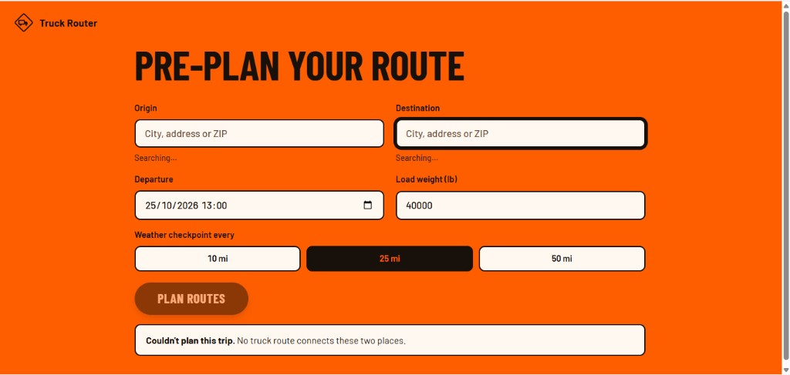

# Weather-Aware Truck Routing

[](https://github.com/hosama-adem/spotter-truck-routing/actions/workflows/ci.yml)

Pick the **safest HGV corridor** by scoring forecast weather at the time the truck arrives — not weather right now.



## What it does

- Plans **three truck routes** (OpenRouteService `driving-hgv`) with via-point fallback so you always get alternatives
- Samples checkpoints every **10 / 25 / 50 mi**, forecasts weather **at each ETA**, classifies risk with **load rules**, and ranks corridors
- Renders routes on a map with a **0–48h corridor heatmap** that scrubs **with no network calls** after one fetch

## Live demo / Loom

| | Link |
|---|---|
| **App** | https://spotter-truck-routing.vercel.app |
| **API health** | https://spotter-truck-routing-api.onrender.com/api/health |
| **Loom** | _add your public Loom URL here after recording_ |
| **Repo** | https://github.com/hosama-adem/spotter-truck-routing |

> The free Render API sleeps when idle. Wake it with `/api/health` first — the first call after sleep can take ~1 minute.

## Architecture

```text
┌─────────────────────┐     POST /api/trips/plan
│  React + Vite (TS)  │     POST /api/weather/heatmap
│  MapLibre + deck.gl │ ─────────────────────────────►
└─────────────────────┘
                              ┌──────────────────────────┐
                              │  Django 5 + DRF          │
                              │  trips/services.py       │
                              │  domain/ (pure logic)    │
                              └───────────┬──────────────┘
                    ┌─────────────────────┼─────────────────────┐
                    ▼                     ▼                     ▼
            OpenRouteService        Open-Meteo            Django cache
            geocode + HGV           hourly wx             (weather +
            routes / vias           batch ≤100            heatmap TTL)
```

| Layer | Choice |
|---|---|
| Frontend | React 19, TypeScript, Vite, MapLibre, deck.gl |
| Backend | Django 5.2, DRF |
| Routing | OpenRouteService `driving-hgv` behind a provider interface |
| Weather | Open-Meteo (mph / inches), batched + cached |
| Hosting | Vercel (UI) · Render (API) |

Product rules: [docs/PRD.md](docs/PRD.md) · build process: [docs/PLAYBOOK.md](docs/PLAYBOOK.md)

## How risk & recommendation work

### Risk levels (ordinal 0–4)

| Condition | Low | Moderate | High | Severe | No Travel |
|---|---|---|---|---|---|
| Wind (mph) | &lt; 25 | 25–34.9 | 35–44.9 | 45–54.9 | ≥ 55 |
| Rain (in/hr) | &lt; 0.10 | 0.10–0.24 | 0.25–0.49 | 0.50–1.00 | &gt; 1.00 |
| Snow (in/hr) | &lt; 0.5 | 0.5–0.9 | 1.0–1.9 | 2.0–3.0 | &gt; 3.0 |

**Load rules** (can only raise wind risk):

1. Wind ≥ 55 → `NO_TRAVEL` for any load  
2. Wind 45–54 **and** load &gt; 30,000 lb → `NO_TRAVEL`  
3. Wind 35–44 **and** load &gt; 40,000 lb → `SEVERE`  

Final checkpoint level = `max(wind_after_load, rain, snow)`.

### Ranking

Miles between checkpoints use the **worse** of the two endpoints (safety-first). Routes sort lexicographically by:

```text
(no_travel_miles, severe_miles, high_miles, avg_risk, duration_seconds)
```

The API returns a human `recommendation_reason` (e.g. fewer severe miles, only slightly slower).

## Assumptions & decisions

1. Wind classification uses **sustained** wind (`wind_speed_10m`); gusts are shown for context only.  
2. Rain = `rain + showers` (hourly ≈ in/hr). Snow = hourly `snowfall` (inches).  
3. Weather is taken at the forecast hour **nearest** each checkpoint ETA.  
4. Heatmap hour **0** = departure; frames cover departure + **0…48h** (49 frames).  
5. **`NO_TRAVEL` ranks worse than `SEVERE`** (documented; safety-first).  
6. ETAs come from provider durations; **no HOS / driver breaks** are modelled.  
7. Long-haul trips always get **3 corridors** via mid-route via-points when native ORS alternatives are capped (≤100 km for native alts on the public API).

**Routing decision:** OpenRouteService `driving-hgv` at `https://api.heigit.org/openrouteservice`. Native alternatives max out at 3 and only for short OD pairs; Chicago→Denver uses via-point fallback. Provider is behind an interface so Mapbox/OSRM can swap in later.

## Performance notes

- Weather: batch ≤100 locations per HTTP call, round coords ~0.1°, cache series ~30 min  
- Heatmap: corridor grid capped at **~300** points × **49** hours; full payload cached  
- UI slider: frames precomputed once; scrubbing only changes an index — **zero network on slide**  
- Map: GPU paths / heatmap via deck.gl  

## Run locally

Python **3.10+** and Node.js **20.19+** (or 22.12+). From the repo root (Windows venv paths shown; on macOS/Linux use `bin/python`):

```bash
cp backend/.env.example backend/.env   # set ORS_API_KEY
cp frontend/.env.example frontend/.env # optional VITE_API_BASE_URL

python -m venv backend/.venv
backend/.venv/Scripts/python -m pip install -r backend/requirements.txt
backend/.venv/Scripts/python backend/manage.py migrate
backend/.venv/Scripts/python backend/manage.py runserver
```

In another terminal:

```bash
cd frontend && npm install && npm run dev
```

- API: http://127.0.0.1:8000 · `GET /api/health` → `{"status":"ok"}`  
- App: http://localhost:5173  

## Tests

```bash
backend/.venv/Scripts/python -m ruff check backend
backend/.venv/Scripts/python -m pytest backend -q

cd frontend && npm run typecheck && npm run lint && npm run build
```

Backend covers risk boundaries, ranking ties, sampling/ETAs, plan + heatmap APIs (providers mocked). Frontend is typechecked and linted; CI runs the same gates on every PR.

## Layout

```text
backend/
  trips/domain/       sampling, corridor grid, risk, ranking (pure)
  trips/providers/    geocode, ORS routing, Open-Meteo weather
  trips/services.py   plan orchestration
  trips/heatmap.py    49-frame corridor risk cube
frontend/
  src/api/            typed clients (geocode, plan, heatmap)
  src/components/     form, map, cards, slider, status banners
docs/
  PRD.md  PLAYBOOK.md  assets/app-trip-form.png
```

## What I’d do next

- Hours-of-Service break stops in ETA math  
- Optional gust-based wind classification toggle  
- Redis for shared weather/heatmap cache across workers  
- Playwright E2E for plan → map → scrub  
- Own Valhalla/OSRM truck profile for higher quota and restrictions  

---

Built for the Spotter assessment · ~13h of the 16h budget · Hosama
